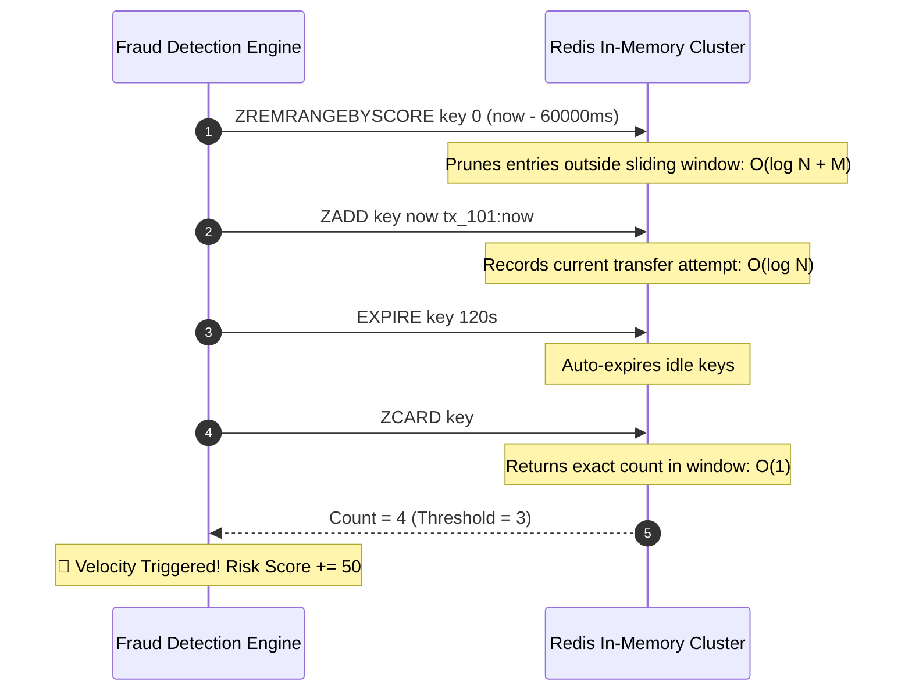
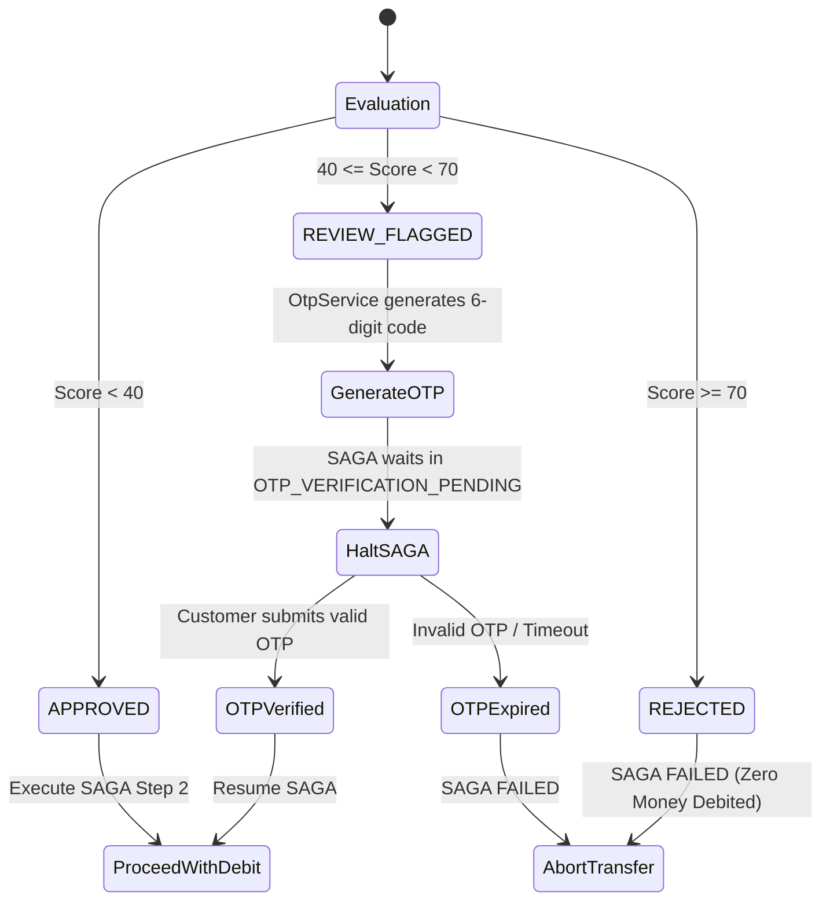
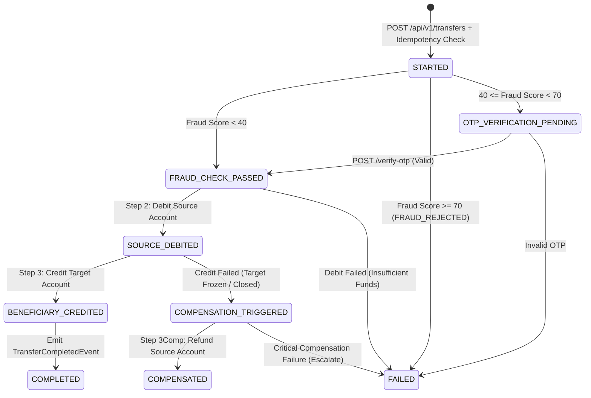
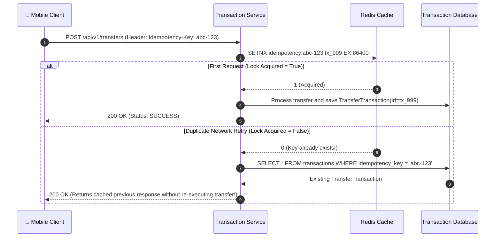

# 🏛️ Digital Banking System: In-Depth Engineering Blueprint
### Real-Time Fraud Detection | Distributed SAGA Orchestration | Double-Entry Bookkeeping | Concurrency Control

---

## 1. The Core Distributed Banking Problem

In single-database monolithic systems, guaranteeing consistency is straightforward: wrap operations inside an ACID database transaction. If any part fails, `ROLLBACK` reverts the entire operation.

```sql
-- Monolithic Transaction (ACID)
BEGIN TRANSACTION;
UPDATE accounts SET balance = balance - 100 WHERE id = 'A';
UPDATE accounts SET balance = balance + 100 WHERE id = 'B';
COMMIT;
```

In a **modern distributed microservices architecture**, this model breaks down completely:
- The **Source Account** is managed by `account-service` in Database A.
- The **Beneficiary Account** is managed by Database B (or an external clearing network like ACH/SEPA/FedNow/UPI).
- The **Fraud Detection Engine** runs in an independent low-latency cache and rule evaluator.

### Why Not Two-Phase Commit (2PC)?
Historically, enterprise distributed transactions used **Two-Phase Commit (2PC / XA transactions)**. Modern high-volume financial institutions have rejected 2PC for four critical reasons:
1. **Thread Pool Starvation & Latency**: 2PC requires the database coordinator to hold table or row locks across network round-trips. If a network partition occurs, locks are held indefinitely, locking out other transfers.
2. **Single Point of Failure**: If the 2PC coordinator crashes during the `PREPARE` phase, participants are left in doubt, blocking databases.
3. **Throughput Bottlenecks**: 2PC scales poorly beyond a few dozen transactions per second. Modern payment gateways require tens of thousands of transactions per second.

### The Solution: BASE & SAGA Pattern
Instead of holding locks across the network, we adopt **BASE** (*Basically Available, Soft state, Eventual consistency*) implemented via the **SAGA Orchestration Pattern**:
- Every distributed transfer is broken into a series of **local transactions**.
- Each service executes its local transaction and updates its local state immediately.
- If a downstream step fails, the **SAGA Orchestrator** executes **Compensating Transactions** in reverse order to undo the previously committed work.

---

## 2. High-Level Architecture & Domain Model

```mermaid
flowchart TD
    Client["📱 Mobile App / Client"] -->|HTTPS / REST| Gateway["🚪 API Gateway (Port 8000)\nToken-Bucket Rate Limiter (60 req/min)"]

    subgraph "Core Microservices Domain"
        Gateway -->|/api/v1/transfers| TxService["⚡ Transaction Service (Port 8080)\nSAGA Orchestrator & Idempotency"]
        Gateway -->|/api/v1/accounts| AccService["🏦 Account Service (Port 8081)\nDouble-Entry Ledger & Lock Manager"]
        Gateway -->|/api/v1/fraud| FraudService["🛡️ Fraud Detection Service (Port 8082)\nRedis Sliding Window Engine"]
        Gateway -->|/api/v1/notifications| NotifService["🔔 Notification Service (Port 8083)\nKafka Consumer & SMS Dispatch"]
        Gateway -->|/api/v1/payments| PayService["💳 Payment Service (Port 8084)\nGateway Webhook Processor"]

        TxService -->|1. Sync Fast-Path Check (<15ms)| FraudService
        TxService -->|2. Debit Source Account| AccService
        TxService -->|3. Credit Beneficiary Account| AccService
        TxService -.->|Compensate Debit on Failure| AccService
        PayService -->|Credit Account on Webhook| AccService
    end

    subgraph "Infrastructure Backbone"
        Redis[("⚡ Redis 7\nIdempotency Keys & Sliding Sets")]
        Postgres[("🗄️ Relational DB (H2 / PostgreSQL)\nAccounts, Sagas & Ledger")]
        Kafka{{"📨 Apache Kafka\nEvent Bus & Auditing"}}
    end

    TxService <--> Redis
    FraudService <--> Redis
    AccService <--> Postgres
    TxService <--> Postgres
    TxService --> Kafka
    AccService --> Kafka
    FraudService --> Kafka
    Kafka --> NotifService
```

---

## 3. Real-Time Fraud Detection Engine (Sub-20ms Pipeline)

### The Timing Problem
If fraud detection runs asynchronously in the background *after* money has been transferred, the money is already gone. Fraudsters utilize automated scripts to drain accounts within seconds. Therefore, fraud detection **must run synchronously in the critical path before funds are debited**, yet execute in **under 20 milliseconds** so the user perceives an instant payment.

### The Sliding-Window Velocity Algorithm
Traditional SQL databases cannot compute velocity across millions of active accounts in real-time. Running:
```sql
SELECT COUNT(*) FROM transactions WHERE account_id = ? AND created_at > NOW() - INTERVAL '60 SECONDS';
```
causes table scans, index lock contention, and high disk I/O.

In [`VelocityRule.java`](file:///c:/Digital%20Banking%20System/fraud-detection-service/src/main/java/com/digitalbanking/fraud/rules/VelocityRule.java), we use **Redis Sorted Sets (ZSET)** implementing a sliding-window log algorithm:

```
Key:   fraud:velocity:<accountId>
Score: Timestamp (epoch milliseconds)
Value: <transactionId>:<timestamp>
```



#### Time Complexity:
- Pruning: $\mathcal{O}(\log N + M)$ where $M$ is the number of expired items.
- Insertion: $\mathcal{O}(\log N)$ where $N$ is the number of items in the 60-second window (typically $N < 10$).
- Cardinality query: $\mathcal{O}(1)$.
- Total execution time in Redis: **$< 1.5\text{ milliseconds}$**.

### The 4 Pluggable Fraud Rules

| Rule Class | Purpose | Logic & Scoring | Action |
|---|---|---|---|
| [`VelocityRule`](file:///c:/Digital%20Banking%20System/fraud-detection-service/src/main/java/com/digitalbanking/fraud/rules/VelocityRule.java) | Prevents rapid bot-draining attacks | Counts transactions in a 60-second sliding window. If $> 3$, assigns **+50 risk points**. | Step-up OTP or block |
| [`AmountAnomalyRule`](file:///c:/Digital%20Banking%20System/fraud-detection-service/src/main/java/com/digitalbanking/fraud/rules/AmountAnomalyRule.java) | Identifies unusual high-value spikes | Checks single transaction magnitude:<br>• $> \$10,000 \rightarrow$ **+45 risk points**<br>• $> \$50,000 \rightarrow$ **+80 risk points** | Step-up OTP or immediate reject |
| [`AccountDrainRule`](file:///c:/Digital%20Banking%20System/fraud-detection-service/src/main/java/com/digitalbanking/fraud/rules/AccountDrainRule.java) | Catches full-account liquidation attempts | Computes $\text{Ratio} = \frac{\text{Amount}}{\text{Balance}}$. If $\text{Ratio} \ge 90\%$, assigns **+40 risk points**. | Step-up challenge |
| [`BeneficiaryRiskRule`](file:///c:/Digital%20Banking%20System/fraud-detection-service/src/main/java/com/digitalbanking/fraud/rules/BeneficiaryRiskRule.java) | Sanction lists & known mule accounts | Instant lookup against blacklisted account IDs (e.g. `ACC-BLACK-9999`) or malicious proxy IPs. Assigns **100 risk points**. | Immediate reject |

### Composite Decision Matrix ([`FraudRuleEngine.java`](file:///c:/Digital%20Banking%20System/fraud-detection-service/src/main/java/com/digitalbanking/fraud/engine/FraudRuleEngine.java))
The total risk score is capped at 100:

$$\text{RiskScore} = \min\left(100, \sum_{i=1}^n \text{Score}(\text{Rule}_i)\right)$$



---

## 4. The SAGA Orchestrator & Distributed Consistency

The orchestrator ([`TransferSagaOrchestrator.java`](file:///c:/Digital%20Banking%20System/transaction-service/src/main/java/com/digitalbanking/transaction/service/TransferSagaOrchestrator.java)) acts as the state machine governing distributed transactions across services.

### SAGA State Machine



### Compensating Transactions in Action
Consider what happens when Alice transfers \$200 to Bob, but Bob's account has been frozen by bank compliance:

1. **Step 1 (Fraud Check)**: Passes (Score: 0).
2. **Step 2 (Debit Source)**: Alice's account is debited by \$200. Her balance drops from \$1,000 to \$800. A `DEBIT` ledger entry is written.
3. **Step 3 (Credit Target)**: The system attempts to credit Bob's account. `account-service` throws `AccountFrozenException("Account Bob is FROZEN")`.
4. **Triggering Compensation**: The orchestrator catches the exception, updates `SagaInstance` to `COMPENSATION_TRIGGERED`, and immediately invokes:
   ```java
   accountClient.compensateDebit(sourceAccountId, amount, txId, sagaId, "Rollback: Beneficiary credit failed");
   ```
5. **Restoring State**: Alice's account balance is re-credited with \$200, restoring it to \$1,000. An immutable ledger entry of type `COMPENSATION` is committed.
6. **Result**: The transaction returns `status: COMPENSATED`. Alice receives an immediate notification: *"Transfer failed at destination, but funds were safely rolled back and refunded to your account."*

### Idempotency Layer ([`IdempotencyService.java`](file:///c:/Digital%20Banking%20System/transaction-service/src/main/java/com/digitalbanking/transaction/service/IdempotencyService.java))
In unstable mobile networks, clients often send duplicate transfer requests when timeouts occur before receiving a server response.



---

## 5. Double-Entry Bookkeeping & Concurrency Control

### Why Direct Balance Mutation is Prohibited
In naive tutorials, money transfer is often implemented as:
```java
// ANTI-PATTERN: NEVER DO THIS IN FINANCIAL SYSTEMS
account.setBalance(account.getBalance() - amount);
accountRepository.save(account);
```
This violates core banking principles:
1. **Lost Updates**: If two transfers of \$100 arrive simultaneously for an account with \$150, both threads read \$150, deduct \$100, and save \$50. The account is double-debited, but the balance only reflects one deduction.
2. **Lack of Auditability**: If an account balance changes, auditors cannot prove *why* it changed without balanced journal entries.

### Double-Entry Ledger Principles ([`LedgerEntry.java`](file:///c:/Digital%20Banking%20System/account-service/src/main/java/com/digitalbanking/account/domain/LedgerEntry.java))
Every balance mutation requires an immutable journal entry recording:
- `entryType`: `DEBIT`, `CREDIT`, or `COMPENSATION`.
- `amount`: The exact currency magnitude.
- `balanceBefore`: Balance snapshot before mutation.
- `balanceAfter`: Balance snapshot after mutation.
- `transactionId`: Foreign reference linking the debit and credit legs.

Fundamental accounting rule enforced:

$$\sum \text{Debits} \equiv \sum \text{Credits}$$

### Concurrency Strategy: Pessimistic Locking with Optimistic Fallback
In [`AccountRepository.java`](file:///c:/Digital%20Banking%20System/account-service/src/main/java/com/digitalbanking/account/repository/AccountRepository.java):

```java
@Lock(LockModeType.PESSIMISTIC_WRITE)
@Query("SELECT a FROM Account a WHERE a.id = :id")
Optional<Account> findByIdWithLock(@Param("id") String id);
```

When thread 1 begins processing a transfer for Account A:
1. It executes `SELECT ... FOR UPDATE` via `PESSIMISTIC_WRITE`.
2. The database places an exclusive row-level lock on Account A.
3. If thread 2 tries to debit Account A simultaneously, it blocks until thread 1 commits or rolls back.
4. An optimistic lock counter (`@Version private Long version;`) guarantees that even if a thread bypasses the lock, concurrent modifications are rejected with an `OptimisticLockException`.

---

## 6. End-to-End Code Walkthrough: A Live Transfer

Tracing what happens when `POST /api/v1/transfers` is called:

```
[Client]
   │  POST /api/v1/transfers (Header: Idempotency-Key: uuid-1)
   ▼
[GatewayForwardingController] (api-gateway:8000)
   │  1. Check RateLimiterService: Token bucket (60 req/min).
   │  2. Forward request to http://localhost:8080/api/v1/transfers.
   ▼
[TransactionController] (transaction-service:8080)
   │  Calls sagaOrchestrator.executeTransferSaga(request)
   ▼
[TransferSagaOrchestrator]
   │  1. Idempotency Check: Checks Redis SETNX idempotency:uuid-1.
   │  2. Saves TransferTransaction (Status: PENDING) and SagaInstance (Status: STARTED).
   │  3. Publishes TransferInitiatedEvent to Kafka topic 'transaction-events'.
   │  4. STEP 1 (Fraud Evaluation): Calls FraudClient.evaluate(...)
   │       ├── Runs VelocityRule (prunes Redis sliding window log).
   │       ├── Runs AmountAnomalyRule, AccountDrainRule, BeneficiaryRiskRule.
   │       └── Returns RiskScore: 0, Decision: APPROVED (< 15ms).
   │  5. STEP 2 (Debit Source): Calls AccountClient.debit(...)
   │       ├── AccountService acquires PESSIMISTIC_WRITE lock on Source Account.
   │       ├── Verifies available balance >= transfer amount.
   │       ├── Deducts balance and saves Account.
   │       ├── Writes LedgerEntry (type: DEBIT, amount, before, after).
   │       └── Emits AccountDebitedEvent to Kafka.
   │  6. STEP 3 (Credit Beneficiary): Calls AccountClient.credit(...)
   │       ├── AccountService acquires PESSIMISTIC_WRITE lock on Target Account.
   │       ├── Adds amount to balance and saves Account.
   │       ├── Writes LedgerEntry (type: CREDIT, amount, before, after).
   │       └── Emits AccountCreditedEvent to Kafka.
   │  7. FINALIZE SAGA:
   │       ├── Updates TransferTransaction status to SUCCESS.
   │       ├── Updates SagaInstance status to COMPLETED.
   │       └── Emits TransferCompletedEvent to Kafka.
   ▼
[NotificationKafkaConsumer] (notification-service:8083)
   │  Consumes TransferCompletedEvent from 'transaction-events'.
   │  Dispatches simulated SMS notification to sender and recipient.
   ▼
[Client Response]
   200 OK: { "status": "SUCCESS", "message": "Money transferred successfully in 38ms" }
```

---

## 7. Cloud Deployment & Containerization (Render & Docker)

To run this system seamlessly both in local development and on cloud platforms like Render:

### Zero-Setup Self-Contained Profile
By default, the application runs on **in-memory H2 database** and **in-memory Redis/Kafka fallbacks**:
- No external PostgreSQL container required to start testing.
- No external Redis required; in-memory thread-safe sliding-window fallbacks automatically handle velocity tracking.
- Web consoles available at `http://localhost:8080/h2-console` and `http://localhost:8081/h2-console`.

### Single-Service Free-Tier Cloud Profile (`banking-server`)
Render's free tier restricts accounts to 1 concurrent web service. The [`banking-server`](file:///c:/Digital%20Banking%20System/banking-server) module consolidates all microservice controllers and the modern Web UI into a single multi-stage Docker container:
- Image: `eclipse-temurin:21-jre-alpine`
- Memory envelope: `-Xms200m -Xmx420m -XX:+UseG1GC`
- Exposes port 8080 (or dynamic `$PORT` injected by Render).
- Deploys cleanly via [`render.yaml`](file:///c:/Digital%20Banking%20System/render.yaml) at **\$0.00/month**.
