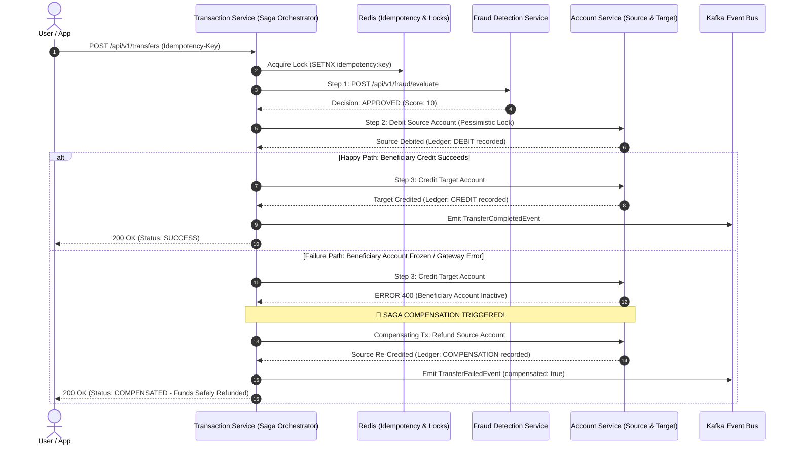

# 🏛️ Production Digital Banking System
### Real-Time Fraud Detection | SAGA Distributed Transactions | Spring Boot 3 | Apache Kafka | Redis

> **"You tap pay. In less than 2 seconds — money transferred. But how do banks DETECT FRAUD in real-time in milliseconds before your account gets drained? And how does a transfer NEVER get stuck halfway even if something fails mid-process?"**

This repository contains the complete, production-grade implementation of a distributed digital banking system inspired by the system design course by **Yeshendra Dhaker**. It is built from scratch with real-world enterprise architectures including double-entry bookkeeping, Redis sliding-window velocity tracking, distributed SAGA orchestration, idempotency locks, and event-driven choreography.

---

## 📑 Architecture Overview

```mermaid
flowchart TD
    Client["📱 Mobile Client / Web App"] -->|HTTPS / REST| Gateway["🚪 API Gateway (Port 8000)\nRedis Rate Limiter"]
    
    subgraph Microservices Architecture
        Gateway -->|/api/v1/transfers| TxService["⚡ Transaction Service (Port 8080)\nSAGA Orchestrator & Idempotency"]
        Gateway -->|/api/v1/accounts| AccService["🏦 Account Service (Port 8081)\nDouble-Entry Ledger & Pessimistic Locks"]
        Gateway -->|/api/v1/fraud| FraudService["🛡️ Fraud Detection Service (Port 8082)\nRedis Sliding Window Engine"]
        Gateway -->|/api/v1/payments| PayService["💳 Payment Service (Port 8084)\nPayment Gateway Webhooks & Top-ups"]
        
        TxService -->|Step 1: REST Fast-Path (<15ms)| FraudService
        TxService -->|Step 2: Debit Source| AccService
        TxService -->|Step 3: Credit Target| AccService
        TxService -.->|Compensating Tx (Rollback)| AccService
        
        PayService -->|Credit Account on Webhook| AccService
    end

    subgraph Event Backbone & State
        Kafka["📨 Apache Kafka (KRaft Event Bus)"]
        Redis["⚡ Redis 7 (In-Memory Cache & Sliding Windows)"]
        Postgres["🗄️ PostgreSQL / H2 (Relational Ledger & Sagas)"]
    end

    TxService -->|Events: transaction-events| Kafka
    FraudService -->|Events: fraud-alerts| Kafka
    AccService -->|Events: account-events| Kafka
    Kafka --> NotifService["🔔 Notification Service (Port 8083)\nCustomer Alerts, SMS, OTP Dispatch"]

    FraudService <-->|ZADD / ZCARD / Sliding Windows| Redis
    TxService <-->|SETNX 24h Idempotency Locks| Redis
    AccService <-->|Pessimistic DB Locks & Versioning| Postgres
    TxService <-->|Saga Instances & Step Logs| Postgres
```

---

## ❓ The Two Core Architectural Questions Answered

### 1. How do banks detect fraud in real-time in milliseconds before your account gets drained?

Modern financial applications evaluate fraud in **sub-20 milliseconds** within the synchronous payment critical path before funds are permanently debited:

1. **Redis Sliding-Window Velocity Checking (`ZADD` / `ZREMRANGEBYSCORE` / `ZCARD`)**:
   - In-memory sorted sets store timestamps of recent user activities with millisecond granularity.
   - When a transfer is initiated, the engine prunes timestamps older than the sliding window (e.g., 60 seconds) and counts transactions in the window.
   - If velocity exceeds thresholds (e.g., > 3 transfers in 60s), a rapid account-draining attack is flagged in $< 2\text{ms}$.
2. **Behavioral Anomaly & Account Drain Detection**:
   - Compares the transfer amount against the sender's current balance. If an attempt is made to drain $> 90\%$ of funds in a single transaction, the risk score spikes.
   - Single-transaction thresholds ($>\$10,000$) require OTP step-up verification; extreme thresholds ($>\$50,000$) are blocked immediately.
3. **Blacklist & Sanction Screening**:
   - O(1) in-memory checks against known mule accounts, compromised IPs, or embargoed lists.
4. **Composite Risk Scoring & Challenge Workflow**:
   - `0 - 39`: **APPROVED** $\rightarrow$ Transfer proceeds immediately.
   - `40 - 69`: **REVIEW_FLAGGED** $\rightarrow$ Step-up 2FA/OTP challenge dispatched to user's phone. SAGA halts until verified.
   - `70 - 100`: **REJECTED** $\rightarrow$ Transaction blocked outright before debit; fraud alert broadcast to security ops.

---

### 2. How does a transfer NEVER get stuck halfway even if something fails mid-process?

In distributed microservices, traditional two-phase commits (2PC) are too slow, lock databases across networks, and create single points of failure. Instead, this system implements the **SAGA Orchestration Pattern**:



### Guarantees:
- **Zero Double-Spending**: Handled via `Idempotency-Key` stored in Redis with 24-hour TTL. Retried requests return previous results without re-executing transactions.
- **Double-Entry Bookkeeping**: Every debit is paired with a corresponding credit or compensation ledger entry. Balance cannot be altered without an immutable audit record.
- **Pessimistic Locking & Versioning**: Prevents race conditions and overdrafts when multiple transfers hit the same source account concurrently.

---

## 📦 Project Modules

| Module | Port | Description |
|---|---|---|
| `banking-common` | N/A | Shared DTOs, Enums, Domain Events, and Custom Banking Exceptions |
| `account-service` | `8081` | Account management, balance updates, pessimistic locks, double-entry ledger |
| `fraud-detection-service` | `8082` | Redis sliding window velocity checks, rule engine, OTP challenge |
| `transaction-service` | `8080` | SAGA Orchestrator, Idempotency lock manager, Transfer state machine |
| `notification-service` | `8083` | Kafka consumer dispatching SMS, Email, and Fraud Ops alerts |
| `payment-service` | `8084` | Payment Gateway integration, deposit order creation & webhook listener |
| `api-gateway` | `8000` | Unified gateway with Redis token bucket rate limiter (60 req/min) |

---

## 🚀 Getting Started

### Prerequisites
- **Java 21**
- **Maven 3.9+** (or bundled IntelliJ Maven)
- **Docker & Docker Compose** (optional: services default to embedded H2 and in-memory caches if Docker is not running)

### 1. Build and Run All Tests
```powershell
mvn clean test
```
All unit and integration tests across all microservices will compile and verify:
- Happy-path SAGA transfers
- SAGA compensation rollbacks on failure
- Redis sliding window velocity fraud checks
- Account double-entry ledger balance integrity

### 2. Start Infrastructure (Docker Compose)
```powershell
docker compose up -d
```
Starts:
- **PostgreSQL 16**: Port `5432`
- **Redis 7**: Port `6379`
- **Apache Kafka (KRaft)**: Port `9092`
- **Kafdrop (Kafka UI)**: Port `9000` (`http://localhost:9000`)
- **Redis Commander**: Port `8085` (`http://localhost:8085`)

### 3. Run Microservices
Run each service from your terminal or IDE:
```powershell
# Terminal 1: Account Service
mvn spring-boot:run -pl account-service

# Terminal 2: Fraud Detection Service
mvn spring-boot:run -pl fraud-detection-service

# Terminal 3: Transaction Service (SAGA Orchestrator)
mvn spring-boot:run -pl transaction-service

# Terminal 4: Notification Service
mvn spring-boot:run -pl notification-service

# Terminal 5: Payment Service
mvn spring-boot:run -pl payment-service

# Terminal 6: API Gateway
mvn spring-boot:run -pl api-gateway
```

---

## 🧪 API Walkthrough & Verification Examples

All APIs can be called directly or via the API Gateway on port `8000`.

### 1. Create Source and Target Accounts
```bash
# Create Alice's Account ($5,000 initial balance)
curl -X POST http://localhost:8000/api/v1/accounts \
  -H "Content-Type: application/json" \
  -d '{
    "accountHolderName": "Alice Smith",
    "email": "alice@bank.com",
    "initialDeposit": 5000.00,
    "currency": "USD"
  }'

# Create Bob's Account ($500 initial balance)
curl -X POST http://localhost:8000/api/v1/accounts \
  -H "Content-Type: application/json" \
  -d '{
    "accountHolderName": "Bob Jones",
    "email": "bob@bank.com",
    "initialDeposit": 500.00,
    "currency": "USD"
  }'
```

---

### 2. Execute a Clean Instant Transfer (< 2 seconds)
```bash
curl -X POST http://localhost:8000/api/v1/transfers \
  -H "Content-Type: application/json" \
  -H "Idempotency-Key: tx-idem-9901" \
  -d '{
    "sourceAccountId": "<ALICE_ACCOUNT_ID>",
    "targetAccountId": "<BOB_ACCOUNT_ID>",
    "amount": 250.00,
    "currency": "USD",
    "ipAddress": "192.168.1.50"
  }'
```
**Response:**
```json
{
  "success": true,
  "message": "Money transferred successfully in 38ms",
  "data": {
    "transactionId": "b8a0...",
    "sagaId": "4c9e...",
    "status": "SUCCESS",
    "amount": 250.00,
    "fraudRiskScore": 0
  }
}
```

---

### 3. Test Real-Time Fraud Prevention (Velocity / Drain / Blacklist)
```bash
# Attempt to transfer to a blacklisted account
curl -X POST http://localhost:8000/api/v1/transfers \
  -H "Content-Type: application/json" \
  -d '{
    "sourceAccountId": "<ALICE_ACCOUNT_ID>",
    "targetAccountId": "ACC-BLACK-9999",
    "amount": 100.00,
    "currency": "USD"
  }'
```
**Result:**
```json
{
  "success": true,
  "message": "Transfer blocked by real-time fraud detection engine",
  "data": {
    "status": "FRAUD_REJECTED",
    "fraudRiskScore": 100
  }
}
```
*Note: Source account balance is NOT debited.*

---

### 4. Test SAGA Compensation (Rollback when Target Fails)
If you initiate a transfer to a frozen or non-existent target account:
1. SAGA debits Alice's account.
2. SAGA attempts to credit the target account $\rightarrow$ fails.
3. SAGA immediately triggers `compensateDebit` $\rightarrow$ refunds Alice's account!
4. Status returns `COMPENSATED`, with double-entry ledger entry `COMPENSATION` created.

Inspect the complete SAGA audit trail:
```bash
curl http://localhost:8000/api/v1/transfers/saga/<SAGA_ID>/audit
```

---

### 5. Inspect Double-Entry Ledger
```bash
curl http://localhost:8000/api/v1/accounts/<ACCOUNT_ID>/ledger
```
Shows balanced immutable debit, credit, and compensation records with balance before and after each transaction.

---

## 🛡️ Key Design Patterns Applied

- **SAGA Pattern (Orchestration)**: Centralized coordination in `transaction-service` with compensating actions for non-blocking distributed transactions.
- **Sliding-Window Counter (Redis)**: Sub-millisecond velocity tracking with automatic TTL expiration.
- **Idempotency Guard**: Prevents double-debiting on mobile network retries via Redis `SETNX`.
- **Double-Entry Bookkeeping**: Strict separation of ledger entries and balance mutations.
- **Pessimistic Locking (`PESSIMISTIC_WRITE`)**: Prevents race conditions during simultaneous concurrent balance updates.
- **Token Bucket Rate Limiting**: Gateway protection against brute-force attacks and DDoS.
